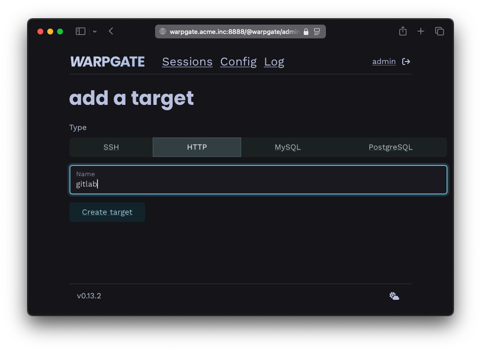
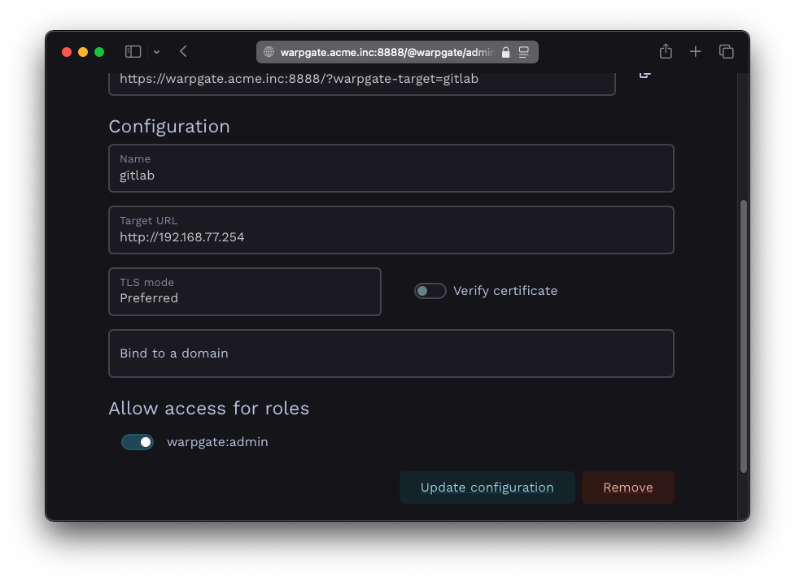
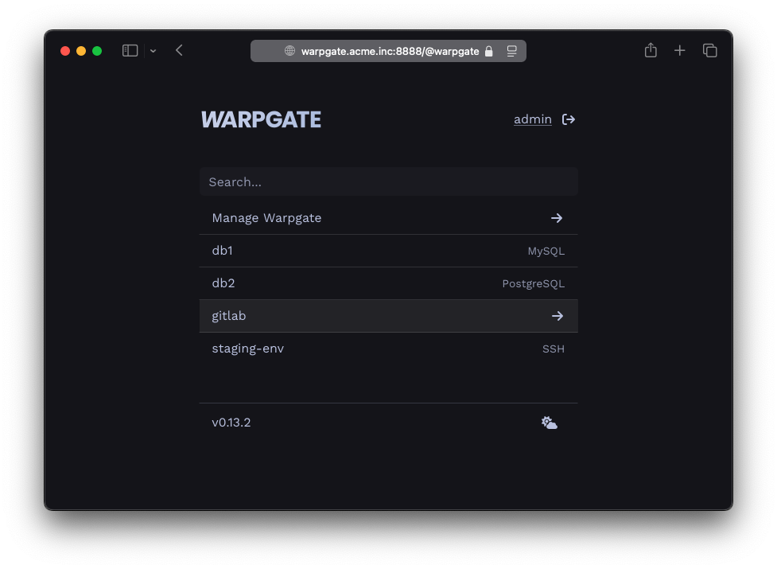
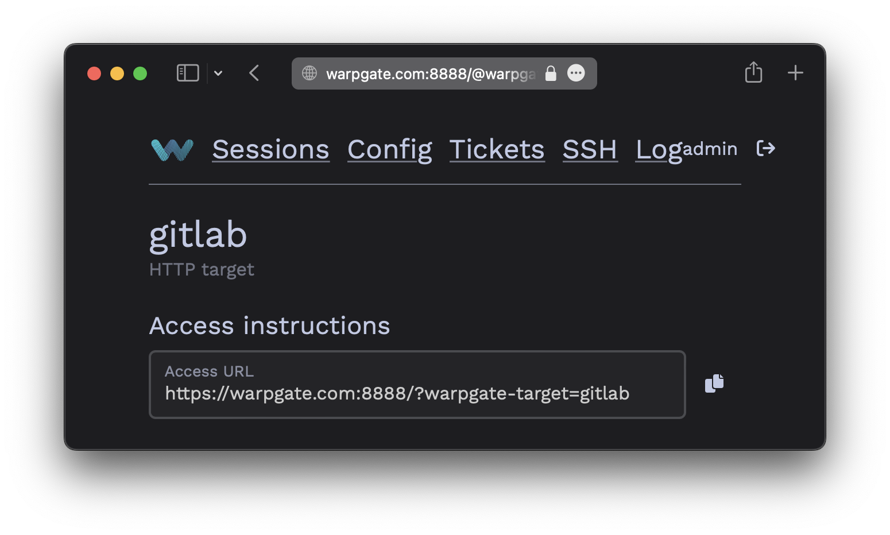
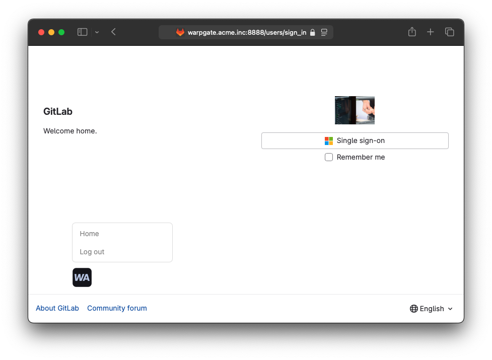

# Adding HTTP targets

## Connection setup

Log into the Warpgate admin UI and navigate to `Config` > `Targets` > `Add target` and give the new HTTP target a name:


/// caption
Adding an HTTP target
///

Fill out the configuration:

* **Target URL**: the destination web service, including the protocol (`http://` or `https://`).
* **TLS mode**: whether to ignore, prefer or require TLS (overrides the URL's protocol).
* **Verify certificate**: whether to reject untrusted certificates.
* **Bind to a domain**: link this target to a specific sub-domain of the domain Warpgate is on - see [HTTP domain binding](../http-domain-binding.md)

Example:


/// caption
HTTP target configuration
///

The target should show up on Warpgate's homepage:


/// caption
HTTP target on the home page
///

# Accessing the target

Users can either access the target by selecting it on Warpgate's homepage, with a direct URL:

```
https://<warpgate host>:<port>/?warpgate-target=<name>
```

You can also find a copyable URL in the _Targets_ section of the admin UI:


/// caption
HTTP connection instructions
///

While the target is active, Warpgate will pass-through all HTTP traffic in this session straight to it. You can return back to the homepage by manually navigating to `/@warpgate`, or by using the injected session menu (shown below). The menu button can be dragged around to stay out of the way and will remember its location.


/// caption
Accessing an HTTP target
///

# A note on security

Since the browser is sending target requests to the same domain that the `/@warpgate` URLs are served from, the target's pages can potentially access Warpgate's API on behalf of the user by making `fetch` requests. If the logged-in user is an admin, that means access to the admin API as well.

If the target's pages' HTML content is untrusted and/or user-controlled (example: an internal wiki where users can edit and share raw HTML pages), you should use [HTTP domain binding](../http-domain-binding.md), which blocks access to the Warpgate API on non-primary domains.

# Custom headers

<div class="badge font-xs text-bg-warning mb-3">v0.12+</div>

You can specify custom HTTP headers that Warpgate will send to the target for every request. This is useful for adding authentication tokens or debugging headers.

## Built-in headers

Warpgate automatically adds the following headers to all requests:

| Header | Description |
|--------|-------------|
| `x-warpgate-username` | The authenticated username |
| `x-warpgate-authentication-type` | The authentication method used (e.g., `user`, `ticket`) |

### Up next

* [User authentication](../auth.md)
